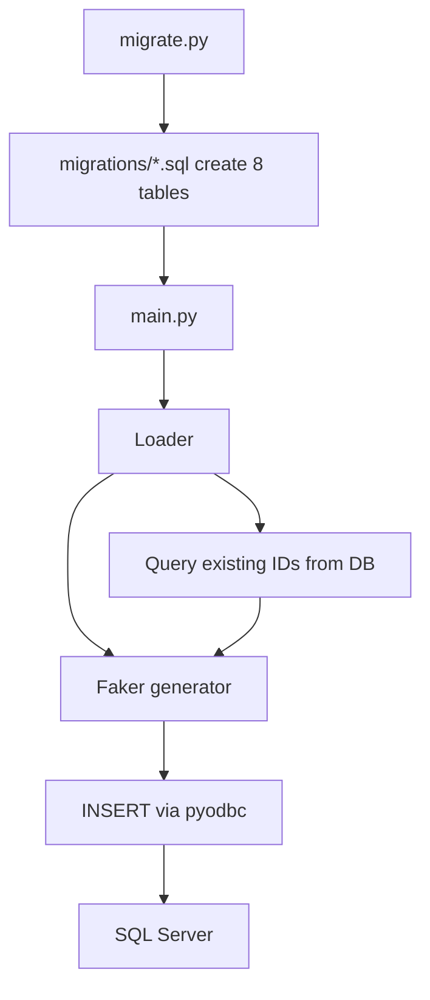
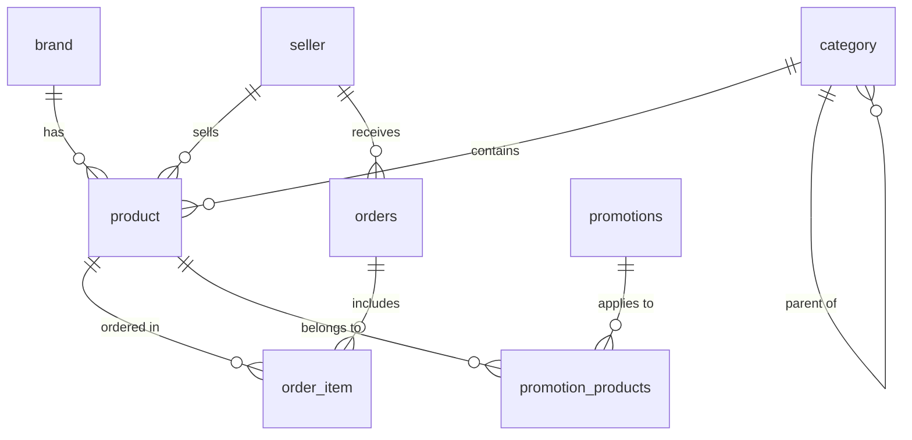

<h1 align="center">Ecommerce Faker</h1>
<p align="center">
  A Python pipeline that generates fake e-commerce data with Faker and loads it into SQL Server through SQL migration scripts.
</p>
<p align="center">
  
  
  
  
  
</p>
<p align="center">
  <a href="#overview">Overview</a> ·
  <a href="#quick-start">Quick Start</a> ·
  <a href="#pipeline-design">Pipeline Design</a> ·
  <a href="#data-model">Data Model</a> ·
  <a href="#generated-data-and-reruns">Reruns</a> ·
  <a href="#known-limitations">Known Limitations</a>
</p>

---

## Overview
This project creates the schema for a small e-commerce database using SQL files, then generates fake data (brands, categories, sellers, products, orders, promotions) with Faker and loads it into SQL Server using `pyodbc`. The resulting dataset is suited to practicing SQL queries, data modeling, and ETL design.

> **Before running:** The repository does **not** include a `.env` file, and the `ecommerce` database must already exist on SQL Server. `migrate.py` creates tables only, not the database. Read [Rerun and cleanup](#rerun-and-cleanup) before running `main.py` a second time.

## Features
| | Capability | Implementation |
|:---:|---|---|
| 🗄️ | Schema migrations | `migrations/*.sql` run in filename order, guarded by `IF NOT EXISTS` |
| 🎲 | Fake data generation | Faker and `random` in `generators/` |
| 📥 | Data loading | Loaders in `loaders/` insert row by row with `pyodbc` |
| 🔗 | Referential integrity | Loaders read real IDs back from the database before generating dependent tables |
| 🌳 | Two-level categories | Parent categories are inserted first, then child categories are mapped to `parent_category_id` |
| 🔐 | Connection config | Credentials are read from `.env` via `python-dotenv` |

---

## Quick Start
### 1. Prepare Python and install dependencies
Use Python 3.10 or later. **ODBC Driver 17 for SQL Server** must be installed on your machine. From the repository root:
```sh
python -m venv .venv
```

Activate the environment for your shell:
```sh
# macOS / Linux
source .venv/bin/activate

# Windows PowerShell
.venv\Scripts\Activate.ps1
```

```sh
python -m pip install -r requirements.txt
```

### 2. Create the database and `.env` file
Create an empty database on SQL Server (the name is up to you, for example `ecommerce`):
```sql
CREATE DATABASE ecommerce;
```

Create a `.env` file in the repository root. `database/connection.py` connects with **SQL Authentication** (`UID` / `PWD`):
```env
DB_SERVER=localhost\SQLEXPRESS
DB_NAME=ecommerce
DB_USER=your_user
DB_PASSWORD=your_password
```

> Do not commit the `.env` file to your repository.

### 3. Test the connection (optional)
```sh
python test_connection.py
```

`test_connection.py` uses a **hardcoded** connection string (`localhost\SQLEXPRESS`, database `ecommerce`, Windows Authentication) and does not read `.env`. If your setup differs, edit this file or skip this step.

### 4. Run migrations
```sh
python migrate.py
```
This creates 8 tables in order `01` → `08`, so every foreign key points to a table that already exists.

### 5. Generate and load data
```sh
python main.py
```

Run all commands from the repository root. `migrate.py` resolves the `migrations` directory relative to the current working directory.

<details>
<summary><strong>Configuration and troubleshooting</strong></summary>

| `.env` variable | Example | Purpose |
|---|---|---|
| `DB_SERVER` | `localhost\SQLEXPRESS` | SQL Server host or instance |
| `DB_NAME` | `ecommerce` | Target database; must already exist |
| `DB_USER` | `your_user` | SQL Server login |
| `DB_PASSWORD` | `your_password` | Password for that login |

Record counts are set directly in each loader's code:

| Loader | Count | Notes |
|---|---:|---|
| `load_brands()` | 30 | Random company names and countries |
| `load_categories()` | 15 | 5 level-1 and 10 level-2 categories from `data/static/categories.py` |
| `load_sellers()` | 20 | Ratings from 3.50 to 5.00 |
| `load_products()` | 200 | Random category, brand, and seller |
| `load_orders()` | 10,000 | Status is `PLACED`, `PAID`, `SHIPPED`, or `DELIVERED` |
| `load_order_items()` | about 30,000 | 1 to 5 items per order |
| `load_promotions()` | 10 | `Flash Sale` or `Seasonal` |
| `load_promotion_products()` | about 100 | 5 to 15 products per promotion |

| Symptom | Check |
|---|---|
| `pyodbc.InterfaceError` or driver not found | Install ODBC Driver 17 for SQL Server, or change the driver name in `database/connection.py` if you use another version. |
| Login error from `migrate.py` or `main.py` | Check `.env`, SQL Authentication permissions, and that SQL Server allows Mixed Mode authentication. |
| `test_connection.py` works but `main.py` fails | The two files authenticate differently. `test_connection.py` uses Windows Authentication, while `main.py` uses `.env`. |
| `FileNotFoundError` for `migrations` | Run `python migrate.py` from the repository root. |
| Foreign key errors while loading | Run `migrate.py` first and keep the loader order in `main.py` unchanged. |
| Duplicated data | Every run of `main.py` inserts new rows. See the rerun section below. |

</details>

---

## Pipeline Design


Load order in `main.py`:

| Step | Loader | Depends on |
|:---:|---|---|
| 1 | `load_brands` | None |
| 2 | `load_categories` | None |
| 3 | `load_sellers` | None |
| 4 | `load_products` | `category`, `brand`, `seller` |
| 5 | `load_orders` | `seller` |
| 6 | `load_order_items` | `orders`, `product`; updates `orders.total_amount` |
| 7 | `load_promotions` | None |
| 8 | `load_promotion_products` | `promotions`, `product` |

| Module | Responsibility |
|---|---|
| `main.py` | Calls the loaders in dependency order |
| `migrate.py` | Runs each `.sql` file in `migrations/` in name order and commits after each file |
| `test_connection.py` | Quick connection check using a hardcoded connection string |
| `database/connection.py` | Builds a `pyodbc` connection from environment variables |
| `generators/` | Produce fake data as lists of `dict`, without touching the database |
| `loaders/` | Read foreign key IDs, call generators, and `INSERT` into the database |
| `data/static/categories.py` | Fixed level-1 and level-2 category lists |
| `migrations/` | DDL scripts, one per table |

<details>
<summary><strong>Project layout</strong></summary>

```text
ecommerce_faker/
├── main.py                  # Runs the full data load
├── migrate.py               # Runs the migration scripts
├── test_connection.py       # Checks the SQL Server connection
├── requirements.txt         # faker, pyodbc, python-dotenv
├── data/static/
│   └── categories.py        # Fixed categories
├── database/
│   └── connection.py        # Connection read from .env
├── generators/              # Fake data generation
│   ├── brand_generator.py
│   ├── category_generator.py
│   ├── seller_generator.py
│   ├── product_generator.py
│   ├── order_generator.py
│   ├── order_item_generator.py
│   └── promotion_generator.py
├── loaders/                 # Load data into SQL Server
│   ├── load_brand.py
│   ├── load_category.py
│   ├── load_seller.py
│   ├── load_product.py
│   ├── load_order.py
│   ├── load_order_item.py
│   ├── load_promotion.py
│   └── load_promotion_product.py
└── migrations/              # DDL, run in order 01 → 08
```

</details>

## Data Model


| Table | Key columns |
|---|---|
| `brand` | `brand_id`, `brand_name`, `country`, `created_at` |
| `category` | `category_id`, `category_name`, `parent_category_id`, `level`, `created_at` |
| `seller` | `seller_id`, `seller_name`, `join_date`, `rating`, `country` |
| `product` | `product_id`, `product_name`, `category_id`, `brand_id`, `seller_id`, `price`, `discount_price`, `stock_qty`, `rating`, `created_at`, `is_active` |
| `orders` | `order_id`, `order_date`, `seller_id`, `status`, `total_amount`, `created_at` |
| `order_item` | `order_item_id`, `order_id`, `product_id`, `quantity`, `unit_price`, `subtotal` |
| `promotions` | `promotion_id`, `promotion_name`, `promotion_type`, `discount_type`, `discount_value`, `start_date`, `end_date` |
| `promotion_products` | `promotion_product_id`, `promotion_id`, `product_id`, `created_at` |

Monetary values are generated between 100,000 and 5,000,000, consistent with VND amounts.

## Generated Data and Reruns
An example `product` row after loading:

```json
{
  "product_id": 1,
  "product_name": "Table",
  "category_id": 7,
  "brand_id": 12,
  "seller_id": 4,
  "price": 1250000,
  "discount_price": 1100000,
  "stock_qty": 240,
  "rating": 4.3,
  "is_active": true
}
```

Quick check after a run:
```sql
SELECT 'brand' AS tbl, COUNT(*) AS n FROM brand
UNION ALL SELECT 'category', COUNT(*) FROM category
UNION ALL SELECT 'seller', COUNT(*) FROM seller
UNION ALL SELECT 'product', COUNT(*) FROM product
UNION ALL SELECT 'orders', COUNT(*) FROM orders
UNION ALL SELECT 'order_item', COUNT(*) FROM order_item
UNION ALL SELECT 'promotions', COUNT(*) FROM promotions
UNION ALL SELECT 'promotion_products', COUNT(*) FROM promotion_products;
```

### Rerun and cleanup
- `migrate.py` can be run repeatedly. Each script checks whether the table exists and skips it if so.
- `main.py` is **not idempotent**. Every run inserts new brands, categories, sellers, products, orders, and promotions, so data is duplicated.
- There is no reset command. To reload from scratch, delete data in reverse foreign key order or recreate the database:
```sql
DELETE FROM promotion_products;
DELETE FROM promotions;
DELETE FROM order_item;
DELETE FROM orders;
DELETE FROM product;
DELETE FROM seller;
DELETE FROM category WHERE parent_category_id IS NOT NULL;
DELETE FROM category;
DELETE FROM brand;
```
- Faker and `random` are not seeded, so each run produces different data.
- Each loader commits once at the end. If a loader fails midway, the tables loaded by earlier loaders are kept.

---

## Known Limitations
<details>
<summary><strong>Source review findings</strong></summary>

| Area | Current behavior |
|---|---|
| Configuration | `test_connection.py` uses hardcoded Windows Authentication, while `database/connection.py` uses SQL Authentication via `.env`. There is no `.env.example`. |
| Repeatability | `main.py` does not check for existing data and has no reset command, so reruns duplicate rows. |
| Data consistency | `order_item.unit_price` is random and is not taken from `product.price` or `discount_price`. |
| Order relationships | Products in an order are chosen randomly and need not share the order's `seller_id`. `orders` has only `seller_id`; there is no customer table. |
| Promotions | `promotions` only link to products and are not used to compute prices or order totals. `discount_value` is always 5 to 50, even when `discount_type` is `fixed`. |
| Categories | Products are assigned to both level-1 and level-2 categories at random. `generators/category_generator.py` and the commented-out block in `load_category.py` are unused. |
| Product names | `product_name` is a single random word (`fake.word().title()`), so names can repeat and do not match the category. |
| Performance | Loaders insert one row at a time with `execute`; `executemany` and `fast_executemany` are not used. |
| Error handling | No explicit `try/except` or rollback; connections are not closed when a loader raises. |
| Packaging | No automated tests, `.gitignore`, or license file. |

</details>

## Roadmap
- Add a `.env.example` and make `test_connection.py` reuse `get_connection()`.
- Add a reset command or ordered `TRUNCATE` logic, plus configurable record counts and a `--seed` option for Faker.
- Derive `unit_price` from product prices and only pick products from the order's seller.
- Add customer and payment tables, and apply promotions to order totals.
- Use `fast_executemany` or batched inserts; add error handling and rollback per loader.
- Add automated tests and a `.gitignore` for `.env`, `.venv/`, and `__pycache__/`.

## Contributing
Open an issue or submit a focused pull request. Include the Python version, SQL Server version, ODBC driver, and the commands used to verify changes. Do not commit `.env` files, credentials, or local virtual environments.

## License
No license file is included in the repository. The project was built for learning purposes; ask the project owner for permission before redistributing the code.

---

<p align="center"><a href="#ecommerce-faker">Back to top ↑</a></p>
